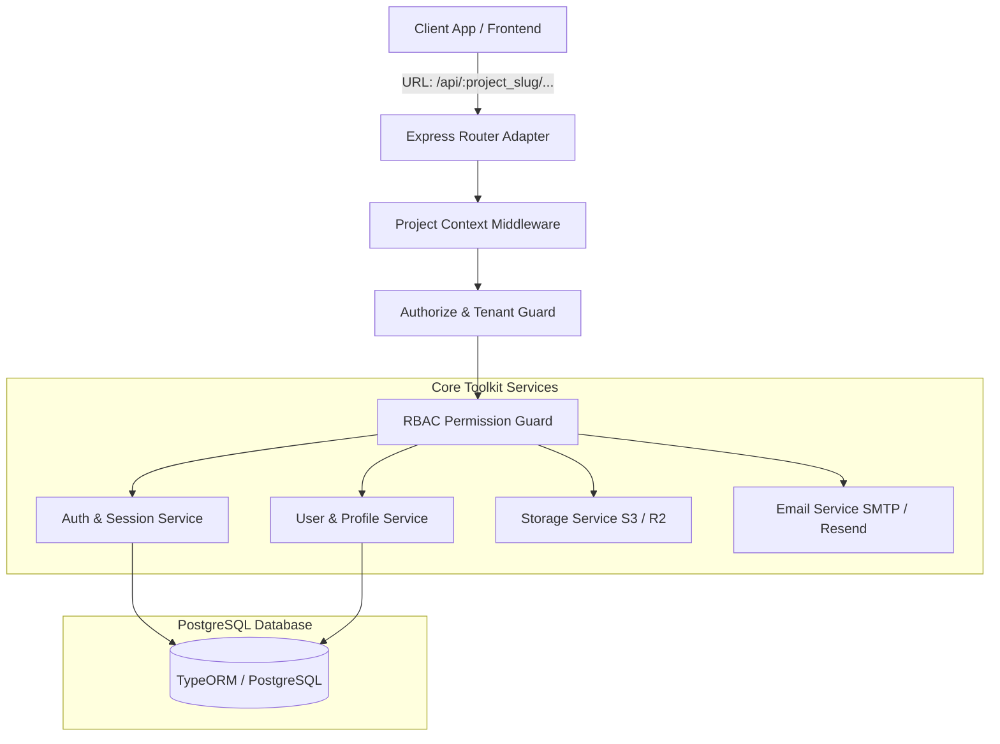

# node-backend-toolkit

<p align="center">
  <strong>A production-grade, multi-project reusable backend toolkit for Node.js, Express, TypeScript, TypeORM, and PostgreSQL.</strong>
</p>

<p align="center">
  <a href="https://www.npmjs.com/package/node-backend-toolkit"></a>
  <a href="https://www.npmjs.com/package/node-backend-toolkit"></a>
  <a href="https://github.com/goyanikrishna/npm-package/blob/main/LICENSE"></a>
  <a href="https://www.typescriptlang.org/"></a>
  <a href="https://github.com/goyanikrishna/npm-package"></a>
  <a href="https://github.com/goyanikrishna/npm-package"></a>
</p>

---

## 🚀 Overview

`node-backend-toolkit` is an enterprise-ready foundation designed to power multiple backend projects from a single reusable package. It eliminates boilerplate by handling **multi-tenant project isolation**, **stateless JWT + refresh token rotation**, **dynamic RBAC**, **extensible SQL user profiles**, **cloud file storage (S3/R2)**, and **branded transactional emails (SMTP/Resend)** without locking you into rigid business schemas.

---

## 🏗️ Architecture



---

## ✨ Features

| Feature | Description |
|---|---|
| **Multi-Project Isolation** | Scopes all data, users, and roles to a project via `/api/:project_slug/...` routing and DB foreign keys. Prevents cross-tenant data leaks. |
| **Authentication Flow** | Self-registration, login, refresh token rotation (`sessions` table), password reset, and secure account self-deletion. |
| **Dynamic RBAC** | System-protected `super_admin` role with automatic bypass, plus fully custom project roles with granular permissions (`users:create`, `users:view`, etc.). |
| **Extensible User Profiles** | Store project-specific user fields as real, typed, indexed SQL columns on `user_profiles` with automated TypeORM migration generation. |
| **Universal File Storage** | Pluggable AWS S3 & Cloudflare R2 providers with project-isolated folder paths, MIME validation, and pre-signed URLs. |
| **Branded Email Engine** | Nodemailer (SMTP) & Resend providers with responsive Handlebars templates (Welcome, Password Reset, Security Alerts) and dynamic branding injection. |
| **Framework-Agnostic Core** | Clean separation of business logic and HTTP adapters; primary Express adapter included out-of-the-box. |

---

## 📦 Installation

```bash
# Core toolkit and peer dependencies
npm install node-backend-toolkit express typeorm pg reflect-metadata
```

*(Optional cloud peer dependencies for AWS S3 / Cloudflare R2 and Resend)*:
```bash
npm install @aws-sdk/client-s3 @aws-sdk/s3-request-presigner resend
```

---

## ⚡ Quick Start

```typescript
import express from 'express';
import { initializeBackend, errorHandlerMiddleware } from 'node-backend-toolkit';

async function bootstrap() {
  const app = express();
  app.use(express.json());

  // 1. Initialize toolkit backend
  const { router } = await initializeBackend({
    project: {
      name: 'Acme Health',
      slug: 'acme-health',
    },
    database: {
      host: process.env.DB_HOST || 'localhost',
      port: Number(process.env.DB_PORT) || 5432,
      username: process.env.DB_USER || 'postgres',
      password: process.env.DB_PASSWORD || '',
      database: process.env.DB_NAME || 'acme_db',
    },
    auth: {
      jwt: {
        access_token_secret: process.env.JWT_ACCESS_SECRET!,
        refresh_token_secret: process.env.JWT_REFRESH_SECRET!,
        access_token_expiry: '15m',
        refresh_token_expiry: '7d',
      },
      password: {
        min_length: 8,
        require_uppercase: true,
        require_digit: true,
      },
    },
    superAdmin: {
      email: 'admin@acme.com',
      first_name: 'Super',
      last_name: 'Admin',
      password: process.env.SUPER_ADMIN_PASSWORD || 'AdminPassword123!',
    },
    users: {
      fields: [
        { name: 'license_number', type: 'string', required: true, unique: true },
        { name: 'department', type: 'string', required: false },
      ],
    },
  });

  // 2. Mount toolkit routes under /api
  app.use('/api', router);

  // 3. Mount central error handler
  app.use(errorHandlerMiddleware);

  app.listen(3000, () => {
    console.log('Server running on http://localhost:3000');
    console.log('Endpoints ready under: http://localhost:3000/api/acme-health/auth/...');
  });
}

bootstrap();
```

---

## 🛠️ CLI Tool

`node-backend-toolkit` includes a built-in CLI to generate TypeORM migrations for your configured dynamic user profile fields:

```bash
# Generate TypeORM migration for custom profile fields
npx node-backend-toolkit generate-migration --config=./toolkit.config.json
```

---

## 📚 Documentation

- [📖 API Source of Truth](https://github.com/goyanikrishna/npm-package/blob/main/docs/API_SOURCE_OF_TRUTH.md) — Comprehensive REST API endpoint catalog with request/response schemas
- [💻 Frontend Integration Guide](https://github.com/goyanikrishna/npm-package/blob/main/docs/FRONTEND_API_INTEGRATION.md) — Guide for frontend developers with Axios interceptor implementation
- [⚙️ Configuration Reference](https://github.com/goyanikrishna/npm-package/blob/main/docs/CONFIGURATION_REFERENCE.md) — Exhaustive guide for all configuration options
- [🗄️ Database & Migration Guide](https://github.com/goyanikrishna/npm-package/blob/main/docs/MIGRATION_GUIDE.md) — Base PostgreSQL schema and dynamic field procedures
- [❓ Architecture Decisions](https://github.com/goyanikrishna/npm-package/blob/main/docs/OPEN_QUESTIONS.md) — Record of architectural decisions (D01-D05)

---

## 🤝 Contributing & License

Contributions, issues, and feature requests are welcome!  
Feel free to check [issues page](https://github.com/goyanikrishna/npm-package/issues).

Distributed under the **MIT License**. See [LICENSE](https://github.com/goyanikrishna/npm-package/blob/main/LICENSE) for more information.
